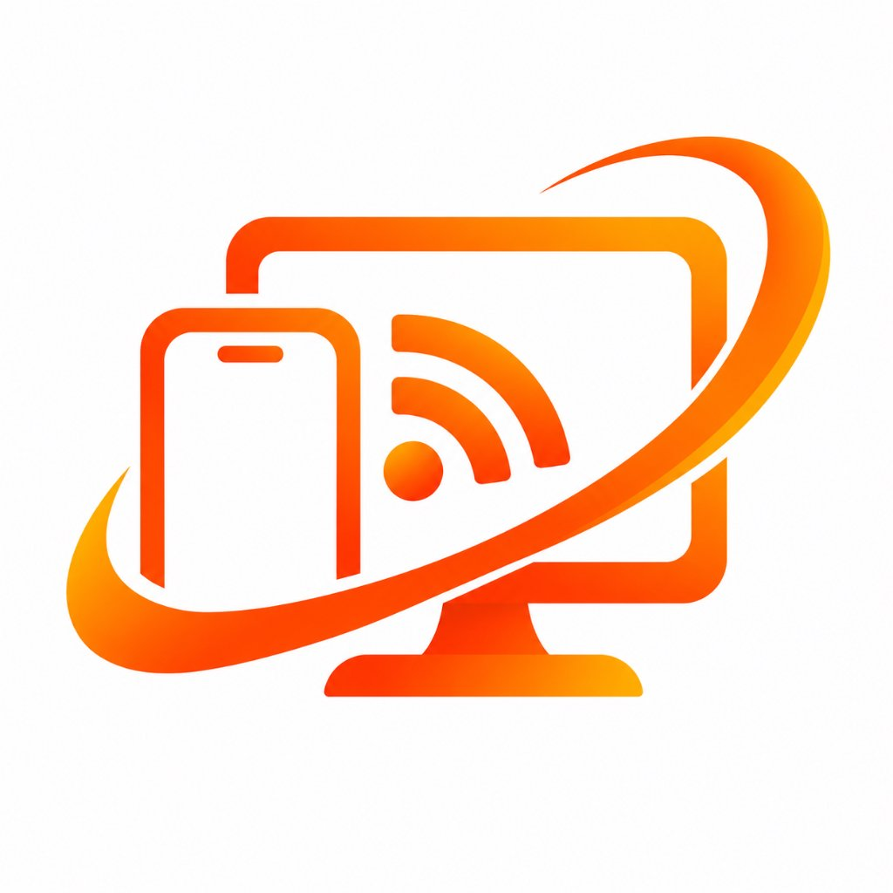

# Mirror

<p align="center">
  
</p>

<p align="center">
  <strong>Next-Gen Open-Source Android Screen Mirroring & Remote Control for Windows via USB and Wi-Fi</strong>
</p>

<p align="center">
  <a href="https://github.com/devfahim/Mirror/releases"></a>
  <a href="#"></a>
  <a href="LICENSE"></a>
  <a href="https://github.com/devfahim"></a>
</p>

---

## 🌟 Overview

**Mirror** is an open-source, ultra-low-latency Android screen mirroring and remote control application engineered for Windows. Built by **Dev Fahim (devfahimbd)**, Mirror empowers you to mirror your phone display at up to 60/120 FPS in FHD/2K, interact via mouse clicks, drags, and PC keyboard input, and operate over high-speed USB cables or wireless Wi-Fi without cloud latency or third-party servers.

---

## ✨ Key Features

- **🚀 Zero-Install USB Mode (Scrcpy-Style):**
  - Plug your phone via USB with *USB Debugging* enabled.
  - No APK installation required on mobile—the PC client automatically pushes a lightweight, 9 KB in-memory Java server (`mirror-server.jar`) and launches mirroring in milliseconds.

- **📶 Dual-Mode Wi-Fi Wireless Streaming:**
  - Connect without cables over your local Wi-Fi.
  - Includes a modern **Mirror Mobile Companion App (`mirror.apk`)** displaying device IP, broadcast status, and 1-tap quick pairing.

- **🪟 Independent "Mirror Cinema" Process:**
  - The mirrored phone display runs in a standalone, dedicated Cinema Viewport process.
  - **Feel free to close or minimize the main Control Center**—your mirror session stays alive and undisturbed!

- **🖱️ Full Interactive Remote Control:**
  - Mouse click to tap, drag to swipe, and scroll wheel to navigate.
  - Type directly into phone apps using your PC physical keyboard.

- **⚡ Floating Quick-Action Dock:**
  - 🔙 **Back**, 🏠 **Home**, 📑 **Recents** (App Switcher)
  - ⚡ **Power** (Lock/Unlock)
  - 🔊 **Volume Up / Down**
  - 📷 **Instant Screenshot** (auto-saved to `Pictures/Mirror`)
  - 🔒 **Screen Off Mode** (mirror while phone display is turned off to save battery & eliminate heat)
  - 📌 **Always-on-Top Pin** & 🖥️ **Fullscreen Mode**

- **🎨 Cyber-Minimalist Dark Aesthetic:**
  - High-end dark UI with ambient glowing neon orange accents inspired by the official Mirror branding.

---

## 📥 Downloads (v1.0.0)

Grab the ready-to-run releases from the [Releases](https://github.com/devfahim/Mirror/releases) page:

| Platform | Package | Description |
|---|---|---|
| **Windows PC** | [**`Mirror-v1.0-Windows-x64.zip`**](https://github.com/devfahim/Mirror/releases/download/v1.0.0/Mirror-v1.0-Windows-x64.zip) | Complete standalone Windows bundle (Includes `mirror.exe`, DLLs, and embedded ADB tools). |
| **Windows PC** | [**`mirror.exe`**](https://github.com/devfahim/Mirror/releases/download/v1.0.0/mirror.exe) | Standalone release executable. |
| **Android Mobile** | [**`mirror.apk`**](https://github.com/devfahim/Mirror/releases/download/v1.0.0/mirror.apk) | Ultra-lightweight Mobile Companion App (~1 MB) for Wi-Fi pairing and streaming settings. |

---

## 🚀 Quick Start Guide

### 1. USB Mode (Fastest & Zero-Install)
1. On your Android phone, enable **Developer Options** and turn on **USB Debugging**.
2. Connect your phone to your PC via a USB cable (allow the RSA prompt on your phone if prompted).
3. Open `mirror.exe` on Windows.
4. Select your detected device and click **"Start Mirror Cinema"**!

### 2. Wi-Fi Wireless Mode
1. Install and launch **`mirror.apk`** on your Android phone.
2. Ensure both PC and phone are connected to the same Wi-Fi router.
3. Note the IP address displayed on the mobile app (e.g., `192.168.1.105`).
4. In `mirror.exe` on PC, enter the IP into the **Wi-Fi Wireless Connect** box and click **Connect**.
5. Click **"Start Mirror Cinema"** and enjoy wireless control!

---

## 🏗️ Architecture

```
[ Android Device ]                                [ Windows PC ]
+----------------------------+                   +----------------------------+
|  mirror-server.jar         |                   |  mirror.exe (Main Hub)     |
|  - SurfaceControl Capture  |   USB (ADB) /     |  - Device Manager & Wi-Fi  |
|  - MediaCodec H.264 HW Enc | <---------------> |  - Quality & Bitrate Setup |
|  - InputManager Injection  |   Wi-Fi (TCP/IP)  +----------------------------+
+----------------------------+                                 |
                                             (Spawns Detached Process)
                                                               v
                                                 +----------------------------+
                                                 |  Mirror Cinema Viewport    |
                                                 |  - Ultra-Low Latency View  |
                                                 |  - Mouse & Touch Events    |
                                                 |  - Floating Action Dock    |
                                                 +----------------------------+
```

---

## 🛠️ Project Structure

```
Mirror/
├── assets/                  # High-resolution logos & brand assets
├── client/                  # Windows Desktop Flutter Client (mirror.exe)
│   ├── lib/
│   │   ├── core/adb/        # ADB detection, tunnels, keyevents
│   │   ├── core/protocol/   # Binary touch & control socket packet encoder
│   │   ├── core/stream/     # Session manager & stream receiver
│   │   ├── ui/cinema/       # Standalone Draggable Cinema Viewport
│   │   └── ui/dashboard/    # Main Control Hub
│   └── windows/             # Native Windows C++ Runner & resource scripts
├── mobile/                  # Android Companion App (mirror.apk)
│   └── lib/                 # Wi-Fi broadcast & device pairing UI
├── server/                  # Android in-memory Java server (mirror-server.jar)
│   └── src/main/java/       # SurfaceControl capture & InputManager injection
├── release/                 # Compiled distribution binaries (exe, apk, zip)
└── scripts/                 # 1-Click build batch scripts
```

---

## 👨‍💻 Author & Credits

Developed with passion by **Dev Fahim (devfahimbd)**.

- **GitHub:** [@devfahimbd](https://github.com/devfahimbd)
- **Repository:** [https://github.com/devfahim/Mirror](https://github.com/devfahim/Mirror)

---

## 📄 License

This project is licensed under the [MIT License](LICENSE).
